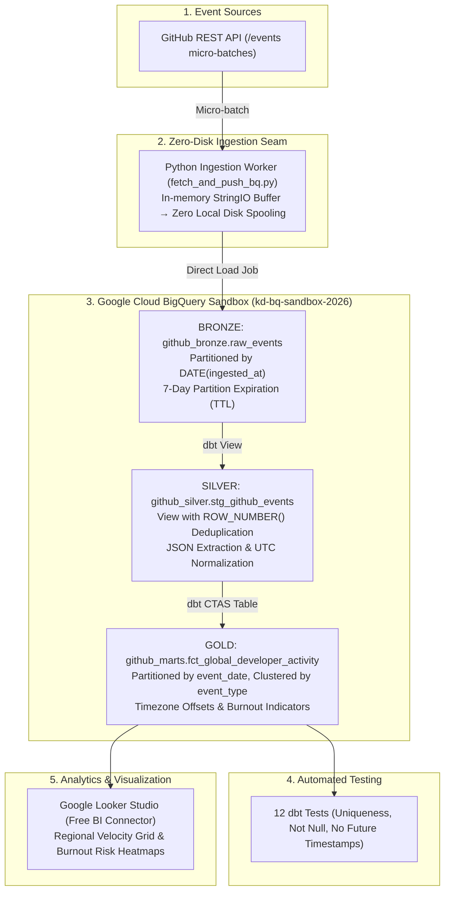

# GitHub Telemetry Lakehouse

[](https://www.python.org)
[](https://www.getdbt.com)
[](https://cloud.google.com/bigquery)
[](https://airflow.apache.org)
[](LICENSE)

> **Zero-Cost Enterprise Developer Telemetry & Productivity Lakehouse** — Streams global GitHub public event micro-batches into Google BigQuery Sandbox, models dimensional regional timelines with dbt Core, and orchestrates with Apache Airflow.

---

## 1. Project Purpose & Executive Summary

In global technology organizations, engineering leadership requires continuous visibility into developer velocity, cross-regional code flow, and workforce sustainability without incurring infrastructure bloat. 

This pipeline models developer telemetry across asynchronous international time zones to answer three critical operational questions:
1. **The "Follow-the-Sun" Engineering Index**: When do development hubs in AMER (New York), EMEA (London), and APAC (Singapore) hit peak contribution hours?
2. **The "Midnight Oil" Burnout Indicator**: What proportion of code commits occur between 10:00 PM and 5:00 AM in the actor's origin timezone?
3. **Storage & Financial Optimization**: How do you architect a high-throughput ELT lakehouse that operates continuously at **$0.00 cloud spend** and **zero local disk leakage** within strict Sandbox and host resource quotas?

---

## 2. Architecture & Medallion Design



---

## 3. Technology Stack & Operational Constraints

| Layer | Technology | Version | Architectural Detail |
| :--- | :--- | :--- | :--- |
| **Orchestration** | Apache Airflow | 2.10 | Continuous micro-batch DAG (`*/15 * * * *`) |
| **Ingestion Engine** | Python (`google-cloud-bigquery`) | 3.12 | In-memory `io.StringIO` streaming load (0 MB local disk footprint) |
| **Lakehouse Compute** | Google BigQuery Sandbox | Serverless | Project `kd-bq-sandbox-2026` — 10 GB free storage, 1 TB free query quota |
| **Transformation** | dbt-bigquery | 1.12.1 | Medallion architecture (View staging $\to$ CTAS dimensional mart) |
| **Quality & Governance** | dbt Data Tests | 1.11 | 11 generic schema constraints + 1 singular temporal business test |
| **Authentication** | OAuth Application Default Credentials (ADC) | ADC | Zero service account JSON keys (enterprise policy compliant) |
| **Task Runner** | `just` | Latest | Single-command developer experience (`just run`, `just dbt-test`) |

---

## 4. Medallion Data Layers

| Layer | Dataset & Relation | Materialization | Granularity & Partitioning |
| :--- | :--- | :--- | :--- |
| **Bronze (Raw)** | `github_bronze.raw_events` | Partitioned Table | 1 row per raw API event. Daily partitioned on `ingested_at` with a 7-day automatic partition TTL. |
| **Silver (Staged)** | `github_silver.stg_github_events` | View | 1 row per unique `event_id`. Unpacks nested JSON with `JSON_VALUE`, normalizes to UTC, deduplicates via window functions. |
| **Gold (Mart)** | `github_marts.fct_global_developer_activity` | Partitioned & Clustered Table | 1 row per developer action. Daily partitioned on `event_date`, clustered by `event_type` and `is_midnight_oil_pushed`. Projects into AMER, EMEA, APAC, and IST regional local times. |

---

## 5. Sample Analytical Queries

### A. The "Midnight Oil" Burnout Query
```sql
SELECT 
    actor_login,
    repo_name,
    created_at_utc,
    amer_local_time,
    is_midnight_oil_pushed
FROM `kd-bq-sandbox-2026.github_marts.fct_global_developer_activity`
WHERE is_midnight_oil_pushed = TRUE
ORDER BY created_at_utc DESC
LIMIT 10;
```

### B. Follow-the-Sun Regional Workload Distribution
```sql
SELECT
    event_hour_utc,
    COUNTIF(is_amer_core_hours) AS amer_active_events,
    COUNTIF(is_emea_core_hours) AS emea_active_events,
    COUNTIF(is_apac_core_hours) AS apac_active_events,
    COUNT(*) AS total_global_events
FROM `kd-bq-sandbox-2026.github_marts.fct_global_developer_activity`
GROUP BY event_hour_utc
ORDER BY event_hour_utc;
```

---

## 6. Quickstart & Execution Guide

### Prerequisites
* Google Cloud SDK (`gcloud`) authenticated via Application Default Credentials:
  ```bash
  gcloud auth application-default login
  ```
* Task runner: `just`

### Setup & Run
```bash
# 1. Provision BigQuery Sandbox datasets and partitioned tables
just setup-bq

# 2. Ingest live micro-batch from GitHub REST API
just ingest

# 3. Execute dbt dimensional models (Silver & Gold)
just dbt-run

# 4. Run data quality tests (12 tests)
just dbt-test

# 5. OR run the entire pipeline end-to-end with 1 command
just run

# 6. Query recent enriched records
just query
```

---

## 7. Connecting Free Looker Studio Dashboards

1. Navigate to [Google Looker Studio](https://lookerstudio.google.com/) (100% free).
2. Create **Blank Report** $\to$ select the **BigQuery** connector.
3. Select Project: `kd-bq-sandbox-2026` $\to$ Dataset: `github_marts` $\to$ Table: `fct_global_developer_activity`.
4. Recommended Charts:
   * **Scorecard**: Total Events Processed.
   * **Pie Chart / Donut**: Breakdown of `is_midnight_oil_pushed` (True vs False).
   * **Time-Series Chart**: Dimension: `amer_local_time` (by hour), Metric: Count of Events.
   * **Table**: Top repositories with out-of-hours contributions.
